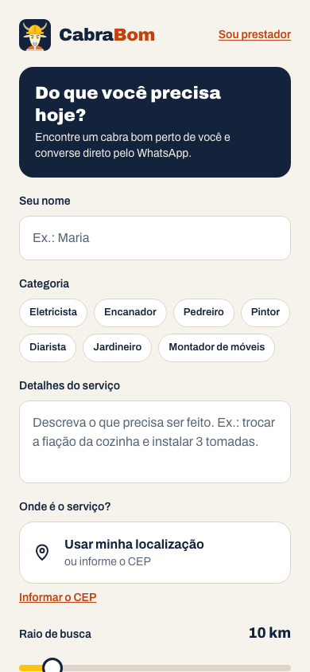
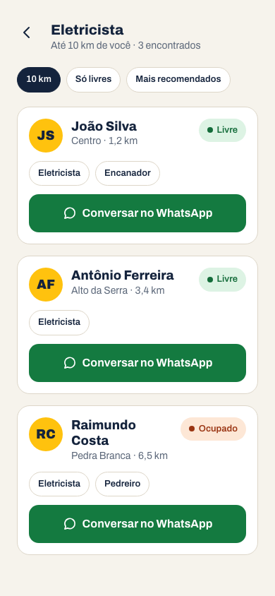
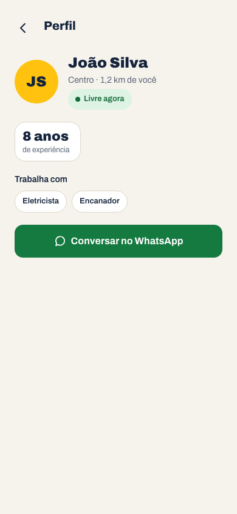
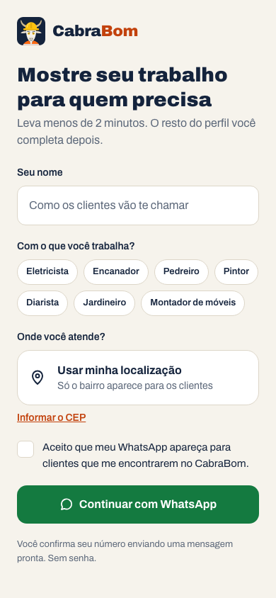
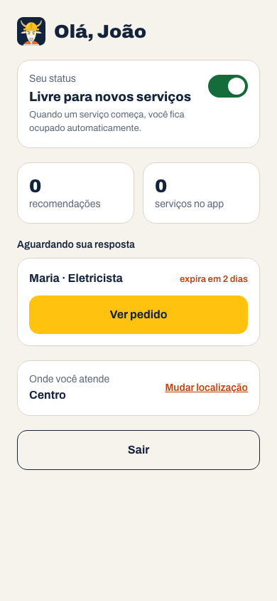
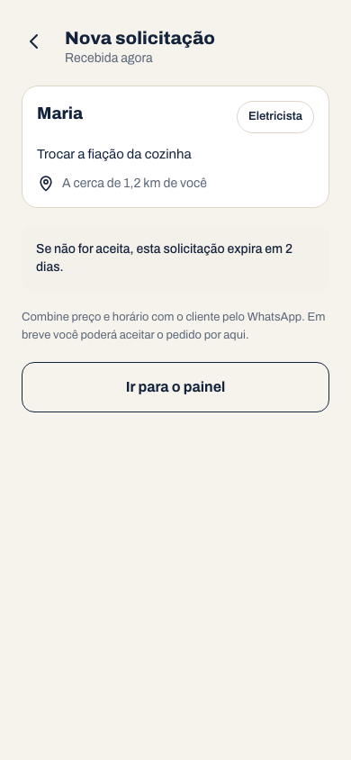

<p align="center">
  
</p>

<h1 align="center">CabraBom</h1>

<p align="center"><strong>Mão de obra de confiança, perto de você.</strong></p>

O CabraBom ajuda quem precisa de um serviço (eletricista, encanador, diarista...) a encontrar prestadores perto de casa, ver quem está livre agora e conversar direto pelo WhatsApp. O nome vem da expressão nordestina "cabra bom": alguém de confiança, que resolve.

> 🚧 **Em construção.** A Fase 1 (núcleo) está pronta: cadastro do prestador, busca, perfil, contato pelo WhatsApp e painel. A Fase 2 traz o ciclo do serviço (aceitar, confirmar, finalizar e recomendar).

## Telas

| Busca | Resultados | Perfil |
|---|---|---|
|  |  |  |

| Cadastro do prestador | Painel | Pedido recebido |
|---|---|---|
|  |  |  |

As imagens são geradas com `npm run screenshots` (dados de exemplo do seed).

## Como funciona

- **O cliente não precisa de cadastro.** Ele informa o nome, o serviço e onde está, e vê os prestadores mais próximos: primeiro os livres, depois os mais perto.
- **A conversa acontece no WhatsApp.** O botão "Conversar no WhatsApp" abre o app com uma mensagem pronta. Preço e horário são combinados direto entre as pessoas.
- **O prestador se cadastra em cerca de 2 minutos**, informando nome, o que faz e onde atende.
- **O login é pelo WhatsApp, sem senha.** O usuário envia uma mensagem pronta (`ENTRAR K7F2Q`) para o número do CabraBom e o app reconhece o número. Como o app só *recebe* mensagens, não há custo.
- **Sem notas, só recomendações.** Clientes podem recomendar o prestador destacando o que foi bom (Pontual, Caprichoso, Preço justo...). Não existe avaliação negativa pública.

## Tecnologias

| Camada | Escolha |
|---|---|
| App | Next.js (App Router) + TypeScript + Tailwind, PWA mobile-first |
| Banco | Postgres + PostGIS no Supabase (local via Docker no desenvolvimento) |
| Login | OTP reverso pela WhatsApp Cloud API, com sessões próprias |
| Testes | Vitest e Playwright |
| Hospedagem | Vercel |

## Como rodar localmente

### Pré-requisitos

- Node.js 22 ou mais recente e npm
- Docker em execução, para o Supabase local

### Passo a passo

```bash
# 1. Dependências
npm install

# 2. Banco local (Postgres + PostGIS) com as migrações e dados de exemplo
npm run db:start
npm run db:reset

# 3. Variáveis de ambiente
cp .env.example .env.local
npx supabase status -o env
# copie API_URL para SUPABASE_URL, SERVICE_ROLE_KEY para SUPABASE_SERVICE_ROLE_KEY
# e ANON_KEY para SUPABASE_ANON_KEY (esta só é usada pelos testes)
node -e "console.log(require('crypto').randomBytes(32).toString('base64url'))"
# cole o resultado em COOKIE_SECRET

# 4. App
npm run dev
```

Abra <http://localhost:3000>. Os dados de exemplo trazem prestadores em Campina Grande (PB).

No Docker Desktop, os containers do banco aparecem agrupados como **cabrabom**. O painel do banco (Supabase Studio) fica em <http://127.0.0.1:54323>. Para desligar tudo: `npm run db:stop`.

### Login sem o número oficial do WhatsApp

Em desenvolvimento, o login funciona sem a API da Meta. Em `/entrar`, toque em "Entrar com WhatsApp" e depois em "Simular mensagem": a página `/dev/whatsapp` faz o papel do webhook. Essa página não existe em produção.

Para testar o cadastro de prestador, abra <http://localhost:3000/prestador>, preencha o formulário e conclua o login pelo simulador com qualquer celular brasileiro (ex.: `83 98888-7777`).

### Testar no celular

Com o celular na mesma rede Wi-Fi, use `npm run dev:https` e abra `https://<IP-do-computador>:3000` (o IP aparece no terminal, em "Network"). O navegador vai avisar que o certificado não é confiável: aceite para continuar. Sem HTTPS, o celular não libera a localização ("Usar minha localização"); só o `localhost` dispensa isso.

### Testes

```bash
npm test           # regras de negócio e componentes (sem banco)
npm run typecheck  # checagem de tipos
npm run test:db    # testes contra o Supabase local (rode npm run db:reset antes)
npm run test:e2e   # fluxo completo no navegador (Playwright)
```

## Estrutura

```
app/          rotas e telas (Next.js)
components/   componentes de interface do guia de design
lib/          regras de negócio, independentes do Next.js
server/       código de servidor que depende do Next (cookies, sessão)
supabase/     migrações e dados de exemplo
design/       logo e SVGs do ícone
scripts/      utilitários (ex.: npm run icons gera os PNGs do PWA)
docs/decisoes registros de decisão (ADRs)
e2e/, tests/  testes
```

## Moderação

Ainda não há tela de gerência (ADR 0041). Pelo painel do Supabase (Table Editor):

1. **Denúncias:** tabela `reports`, filtrando `resolved = false`. Depois de tratar, marque `resolved = true`.
2. **Ocultar um prestador:** em `providers`, `hidden = true`. Ele some da busca e do perfil.
3. **Ocultar uma recomendação:** em `recommendations`, `visible = false`. Confira também as que têm `flagged = true` (ADR 0038).

## Decisões

As escolhas de produto e arquitetura estão registradas em [`docs/decisoes/`](docs/decisoes/README.md), com contexto, alternativas e consequências.

## Contribuindo

- O trabalho segue o fluxo de `develop`, branches `feature/*` e pull requests.
- Os commits seguem Conventional Commits, em português.
- Cada PR sobe a versão do `package.json`: o segundo número para funcionalidades e o terceiro para correções e ajustes.

## Licença e uso de IA

O código, a documentação e os SVGs do ícone estão sob a [licença MIT](LICENSE). Se você publicar um fork, use outro nome e outro ícone.

O projeto é construído com assistência de IA (Claude). Cada ADR indica se a decisão foi proposta pelo autor, pela IA ou pelos dois.
